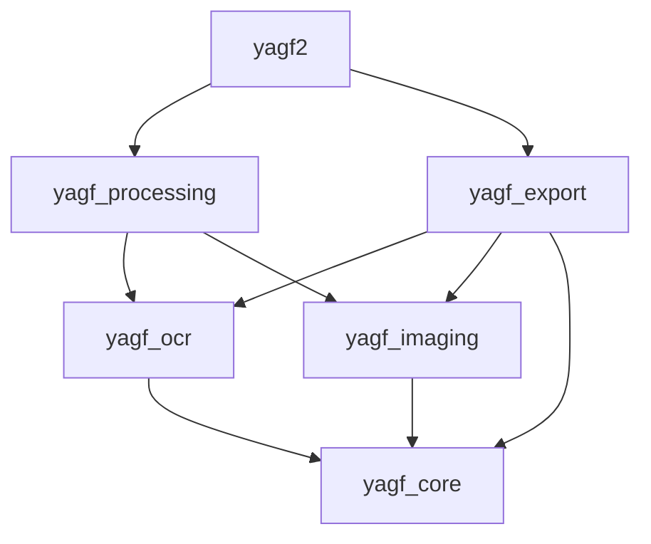

# Code organization

The Qt 6 application builds from the repository root. The `legacy` branch preserves the Qt 4 application and its build system.

```text
YAGF/
  CMakeLists.txt
  src/
    main.cpp                         application entry point
    core/ocrbenchmark.{h,cpp}        bounded Unicode CER/WER and saved-geometry diagnostics
    experiments/experimentrunner.{h,cpp}  immutable pipeline experiments and report aggregation
    experiments/main.cpp            headless benchmark CLI
    ui/experimentdialog.{h,cpp}      verified reference workflow, pipeline setup, report inspection
    processing/pageorientation.{h,cpp}   optional cancellable Tesseract OSD
    core/ocrdocument.{h,cpp}         OCR data, text/JSON export
    core/correctionretention.{h,cpp}  conservative span matching, pending restoration, DPI geometry scaling
    core/verificationqueue.{h,cpp}    document-wide issue analysis with injected spelling checks
    core/spellchecker.{h,cpp}         optional Enchant runtime backend shared by editor and queue
    core/rendersettings.h            supported render resolutions and persisted policy
    core/wordeditor.{h,cpp}          source-linked split, merge, insert, delete
    core/projectfile.{h,cpp}         versioned and portable project save/load
    core/preprocesssettings.h         per-page, persisted quality options
    processing/documentprocessor.{h,cpp}  async OCR jobs, PDF rendering and batching
    processing/iocrengine.h          engine contract and capability flags
    processing/tesseractengine.{h,cpp}    Tesseract subprocess and TSV adapter
    processing/remoteocrengine.{h,cpp}   HTTP client for PaddleOCR and docTR services
    processing/imageprocessor.{h,cpp}     deskew detection, contrast, denoise, rotation
    export/exporttypes.h            shared export result and progress contract
    export/exportpage.{h,cpp}        oriented/preprocessed source-page loading
    export/pdfexporter.{h,cpp}       PDF lifecycle, PDF/A conversion, atomic output
    export/scientificbookexporter.{h,cpp}  scientific HTML export
    export/verifiedsampleexporter.{h,cpp}  verified correction-sample export
    export/detail/pdfpagelayout.{h,cpp}   export-only layout analysis and recovery
    export/detail/pdfpagepainter.{h,cpp}  text fitting and page painting
    export/detail/pagebackground.{h,cpp}  paper-color sampling
    export/detail/exportcommand.{h,cpp}   cancellable export subprocesses
    ui/mainwindow.{h,cpp}            page view, selection, editing, user actions
    ui/verificationcontroller.{h,cpp} queue dock, list model, filtering, navigation
    ui/mainwindowreview.cpp           document/UI glue for review and render settings
    ui/preprocessdialog.{h,cpp}       before/after preview and quality controls
    ui/layoutdialog.{h,cpp}           region geometry, type, and reading order
    ui/documentcommands.{h,cpp}       undoable page and layout commands
  service/server.py                  optional PaddleOCR or docTR inference service
  service/tests/test_server.py       protocol tests with fake inference
  tests/ocrdocument_tests.cpp
  tests/projectfile_tests.cpp
  tests/imageprocessor_tests.cpp
  tests/pdfexporter_tests.cpp
```

Types live in `yagf::core`, `yagf::processing`, and `yagf::ui`. Export classes retain the `yagf::processing` namespace and their existing public entry points, but now live in `src/export` and build as a separate library. The exporter reads an immutable `OcrDocument` snapshot.

## Build boundaries

CMake enforces the dependency direction through separate libraries:



| Target | Owns | Qt dependencies |
| --- | --- | --- |
| `yagf_core` | Document model, geometry, corrections, projects | Core only |
| `yagf_imaging` | Image preprocessing, source commands, symbol rasters | Gui |
| `yagf_ocr` | OCR providers, specialist readings, font estimation | Gui; Network private to provider implementation |
| `yagf_processing` | Async document jobs, thumbnails, batching | Concurrent |
| `yagf_export` | Export orchestration, source loading, layout preparation, painting | Gui; imaging and OCR support private |
| `yagf_experiments` | Verified reference evaluation, pipeline execution, immutable hypotheses and reports | Gui; source loading and providers through existing targets |
| `yagf2` | Main window and dialogs | Widgets; Network explicitly for AI review |

Neither imaging nor OCR providers depend on `DocumentProcessor`. Export depends on provider support, not on the asynchronous document controller, widgets, or Qt Concurrent. The UI links the controller and exporters independently. Tests link the smallest relevant target. In particular, core targets compile without Gui headers or linkage, and export-only tests do not link the document controller. The optional Python service and Jetson runtime are separate from the desktop binary. The application uses C++23, including `std::expected` for image-processing errors and `std::span` for skew scoring.

## Data ownership

The `OcrDocument` is the current in-memory source of truth. It contains numbered pages with user-drawn image regions and recognized regions, paragraphs, lines, and words. Image regions are independent of OCR words, so they can be drawn before recognition and survive OCR page rebuilds. Stable IDs connect each line to its words; the project file also records an explicit word-ID reading order for each page. Each word stores a union box and source fragments, original reading, corrected reading, source word IDs, confidence, review state, and font family, bold/italic/size styling, and source pixel-size estimates. Plain text, layout HTML, JSON, and the project file read from this document. The UI draws the current page's boxes and word list from it. `WordEditor` aligns unchanged words and maps split, merged, inserted, and deleted text onto page geometry. Qt undo commands keep before/after page snapshots and restore hierarchy and reading order together. Pages also retain source-linked deletions and pending corrections. `retainCorrections` groups related verified words and matches contiguous fresh OCR spans using text similarity and geometry, with ambiguity thresholds; unmatched work remains pending. `restorePendingCorrection` applies a user-approved reading to current words or restores it at its saved position. The verification analyzer deduplicates reasons per word and accepts an injected spelling callback; it needs no widgets or Enchant itself. `SpellChecker` dynamically loads optional Enchant 2 through Qt Core's QLibrary. The dock controller owns the list model, filters, coalesced refreshes, and navigation signals; MainWindow owns page loading and undoable document changes.

## Processing boundary

`symbolrules` in Core owns book/shared rule schemas, reviewed datasets, fingerprinted prototype training, classification thresholds, and atomic library persistence. `yagf_symbols` depends on imaging and implements normalized ink descriptors, connected-component/template candidate search, exact character-box alignment, and augmentation of OCR text. It has no controller, export, or widget dependency. `DocumentProcessor` snapshots book and shared rules on its owning thread before a job; its worker applies trained rules after recognition analysis. Raw OCR bypasses the augmentation. Conflicting labels and uncertain character alignment keep the base reading. Unread-symbol insertions require a nearby text-line anchor and avoid existing/non-text geometry.

`SymbolRulesDialog` works on immutable book input and private copies of rules. Search, crop source loading, and book-wide previews run on cancellable workers using the shared page loader. Every mined example starts pending. Only explicitly reviewed positives and negatives train a model. Session credentials remain outside the project/model. The optional Python worker returns portable classifiers over reviewed masks and is verified by the client. Saving book rules and accepted page updates creates one undoable transaction; a shared library is persisted atomically. The UI never overwrites the underlying OCR provider's model files.

`IOcrEngine::recognizeResult` accepts a `QImage`, options, and `std::stop_token`, and returns native `RecognitionResult` evidence or an error. Text regions declare word, line, paragraph, block or page granularity; optional pixel bounds, parent IDs and shared ordering retain model geometry and hierarchy. Formulas, tables and figures have separate records. Markdown, structured output and model provenance remain separate from edits. The nonvirtual `recognize` convenience method calls `recognitionToPage` for existing editor-oriented consumers. No engine implementation is required to produce `OcrPage`. The adapter preserves real word geometry, maps coarse output to whole editable blocks, and marks a coordinate-free page block with `geometryInferred`; it has no source boxes. `OcrPage::recognitionEvidence` and companion readings persist the original results, including crop placement, without overwriting them during editing. Existing schema-2 projects without evidence still open. `TesseractEngine` owns its subprocess and TSV parser. `RemoteOcrEngine` encodes a PNG, calls the versioned Python HTTP service, and validates PaddleOCR line geometry or docTR word geometry and reading order. `DocumentProcessor` runs the engine on a Qt Concurrent worker, owns PDF rendering and thumbnail subprocesses, schedules batch pages, and propagates cancellation. The UI receives normalized pages and translates region coordinates back to the source page. Core uses Qt Core and Qt Gui value types (`QTransform` and `QPolygonF`) for coordinate geometry; it has no widget, recognition provider, subprocess, Python, or remote-service dependency. External commands receive argument lists, never shell command strings.

`ImageProcessor` estimates page skew and luminance range, then applies optional denoise, contrast stretching, and rotation. `MainWindow` keeps the original image in memory, writes the processed page to a temporary PNG for recognition, and displays that same processed image. Project files store settings and both source and processed dimensions; reopening a project recreates the temporary image from the source. `CoordinatePipeline` records source-to-processed steps explicitly. Affine/perspective steps use `QTransform`; dewarping uses a validated, invertible bilinear displacement grid. `QImage::trueMatrix` preserves the raster origin conventions. The current processing order is render, restored-image mapping, orientation, optional normalized perspective, bend, and fine deskew. Point mappings are reversible; pixel boxes use outward bounds of mapped outlines. `GeometryAnchor` retains source outlines and fragments, detects later editor geometry changes, and prevents repeated rotations from growing boxes. `remapPageGeometry` moves words, formulas/tables, layout hierarchy, image areas, pending/deleted corrections, and comparison readings without changing their IDs, text, review state, or order. `retainCorrections` uses the same source frame before matching a new OCR pass; incompatible frames leave corrections pending. A mapping that loses a complete region or cannot be inverted fails atomically, keeping the existing page. Native evidence remains immutable, with a `sourceToInput` snapshot; `recognitionOutlineOnPage` maps its coordinates into the current page. Project JSON deduplicates shared deformation fields in `recognition_frames`, independently of the editable geometry. Standalone recognition JSON remains self-contained. Legacy projects acquire their missing mappings when opened; restored rasters without historical geometry retain an explicit restored-image source frame. Rendering policy lives on the document, while each page stores its actual DPI. Render caches include page number and DPI; saved page DPI takes precedence over the default policy. Adaptive rendering analyzes a 150 DPI pilot using `recommendedRenderDpi` and selects a supported resolution, bounded by estimated pixel count. Explicit DPI changes scale all processed coordinates and source dimensions together; undo to an older page snapshot triggers a render at that snapshot's DPI. Arbitrary source-size changes still fail validation.

## Export boundary

`formulatext` in Core converts bounded formula expressions to linear Unicode, identifies delimited spans, and validates retained source against the current visible reading. `OcrDocument::unicodeFormulas` stores the project choice. Unicode words retain canonical `latexText` for editing and export; text edits invalidate that retained source so later formatting never replaces an edited reading with stale LaTeX. The representation switch snapshots pages and mode in one undo command. Recognition applies the choice after analysis, while raw OCR bypasses conversion.

`LatexDocumentExporter` writes reviewed text, formulas, tables and figure crops through an atomic destination file. It escapes prose and reuses the math-command validator, with known Unicode support for document sources. Figure assets are staged alongside the destination and published in a unique directory before committing the `.tex` file; cancellation or failure removes only new assets. The source supports pdfLaTeX for Latin/Cyrillic and LuaLaTeX with fontspec/unicode-math. Formula editing and PDF typesetting read validated canonical formula text independently of the visible output mode.

`ExportResult` and `ExportProgress` are shared contracts in `exporttypes.h`. Scientific HTML and verified sample exports each have their own public header; neither includes or uses the PDF exporter. `readExportPage` owns source decoding, orientation, preprocessing, and source-dimension validation. Each exporter uses that common loader, which renders at saved per-page DPI and records it on the returned image. The PDF writer converts pixels to physical points using that DPI, so mixed-resolution documents retain page size and block positions. External export commands share one cancellable, timed runner.

`PdfExporter` owns the PDF writer, page sequence, source loading, optional OCRmyPDF conversion, and atomic destination replacement. It composes two separate operations for formatted output:

1. `preparePdfPage` copies the source page, estimates fonts, recovers coarse line geometry when supported, and returns a `PdfPageLayout`. Recovery accepts a geometry-provider callback; it neither constructs Tesseract nor starts processes. The PDF coordinator supplies its cancellable Tesseract adapter. Provider absence or failure falls back to the saved blocks.
2. `drawFormattedPage` consumes the prepared layout and source image through const references. It owns text fitting, clipping, background painting, and retained raster areas. It never performs OCR, filesystem access, or job scheduling.

`PdfPageLayout` contains export-only text erasure areas and raster-retention decisions alongside its temporary page copy. Those instructions are not represented as empty or synthetic regions in the core model. Saving a project cannot accidentally persist export cleanup instructions. Font and layout estimation do not modify the document snapshot supplied by the caller.

Searchable-scan PDF export paints the source image and an invisible corrected-text layer. Formatted PDF export paints corrected text in the source blocks while retaining image, table, formula, and unreliable decorative-heading regions. PDF/A uses OCRmyPDF in skip-text mode. All formats preserve the existing cancellation and atomic-write behavior. The UI runs export through Qt Concurrent and receives the shared result/progress types; the exporter itself has no UI job-controller dependency.

`pdfpagelayout_tests` supplies a geometry provider directly and checks line placement, image retention, model immutability, fallback, cancellation, and painting without invoking Tesseract or PDF command-line tools. Existing integration tests continue to cover real PDF/DjVu commands, embedded fonts, searchable text, multipage export, and the UI save flow.

## Experiment boundary

`yagf_experiments` consumes immutable document snapshots and provider instances; it has no `DocumentProcessor` or widget dependency. It uses the shared export-page loader to obtain raw source renders, applies candidate preprocessing locally, and runs providers without project vocabulary/correction hints. `ocrbenchmark` in Core scores Unicode code points and tokens with bounded rolling edit-distance rows. Geometry diagnostics are unavailable when transforms/granularity disagree. The runner owns calibration warmups, rotated pipeline ordering, cancellation, input/provenance hashing, hypothesis retention, and pooled report summaries. Selection uses calibration metrics only; held-out results cannot switch an engine. `yagf2-benchmark` and `ExperimentDialog` share this implementation.

Reference confirmation in the dialog modifies only its snapshot. The UI sends progress through queued signals and owns no worker-side document state. Session credentials are omitted from pipeline serialization. Tesseract's optional benchmark memory collection uses a separate process group so cancellation also stops its GNU time child. Remote telemetry declares its scope; the VL bridge cannot measure its upstream GPU model. The read-only Python Jetson collector provides separately timestamped hardware observations.

The source preprocessing model now persists right-angle orientation and adaptive-binarization choices. Fine skew always uses a locally thresholded mask; choosing binarization of the actual OCR image is separate. `pageorientation` owns optional Tesseract OSD, timeouts, and cancellation. The dialog runs it asynchronously. Orientation, fine skew, smooth bend, and traced-line restoration preserve recognition geometry through the source frame. Contrast, denoise, shadow leveling, and binarization have no geometric step. Perspective is available in the preprocessing/coordinate API; this change adds no perspective-corner editing UI.

## Next implementation slices

1. Add Flatpak packaging and test releases on supported Linux distributions.
2. Test PaddleOCR GPU inference and performance on the target Jetson hardware.
