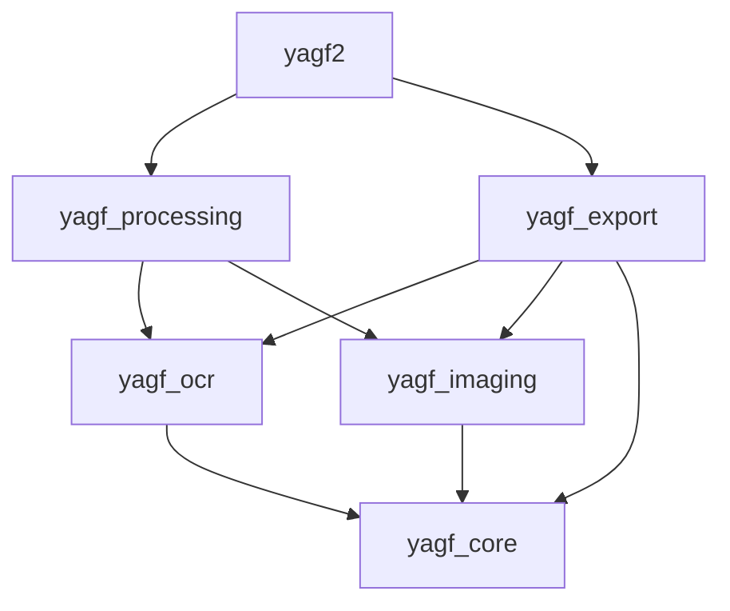

# Code organization

The Qt 6 application builds from the repository root. The `legacy` branch preserves the Qt 4 application and its build system.

```text
YAGF/
  CMakeLists.txt
  src/
    main.cpp                         application entry point
    core/ocrdocument.{h,cpp}         OCR data, text/JSON export
    core/wordeditor.{h,cpp}          source-linked split, merge, insert, delete
    core/projectfile.{h,cpp}         versioned and portable project save/load
    core/preprocesssettings.h         per-page, persisted quality options
    processing/documentprocessor.{h,cpp}  async OCR jobs, PDF rendering and batching
    processing/iocrengine.h          engine contract and capability flags
    processing/tesseractengine.{h,cpp}    Tesseract subprocess and TSV adapter
    processing/remoteocrengine.{h,cpp}   HTTP client for PaddleOCR and docTR services
    processing/imageprocessor.{h,cpp}     deskew detection, contrast, denoise, rotation
    export/exporttypes.h            shared export result and progress contract
    export/exportpage.{h,cpp}        oriented/preprocessed source-page loading
    export/pdfexporter.{h,cpp}       PDF lifecycle, PDF/A conversion, atomic output
    export/scientificbookexporter.{h,cpp}  scientific HTML export
    export/verifiedsampleexporter.{h,cpp}  verified correction-sample export
    export/detail/pdfpagelayout.{h,cpp}   export-only layout analysis and recovery
    export/detail/pdfpagepainter.{h,cpp}  text fitting and page painting
    export/detail/pagebackground.{h,cpp}  paper-color sampling
    export/detail/exportcommand.{h,cpp}   cancellable export subprocesses
    ui/mainwindow.{h,cpp}            page view, selection, editing, user actions
    ui/preprocessdialog.{h,cpp}       before/after preview and quality controls
    ui/layoutdialog.{h,cpp}           region geometry, type, and reading order
    ui/documentcommands.{h,cpp}       undoable page and layout commands
  service/server.py                  optional PaddleOCR or docTR inference service
  service/tests/test_server.py       protocol tests with fake inference
  tests/ocrdocument_tests.cpp
  tests/projectfile_tests.cpp
  tests/imageprocessor_tests.cpp
  tests/pdfexporter_tests.cpp
```

Types live in `yagf::core`, `yagf::processing`, and `yagf::ui`. Export classes retain the `yagf::processing` namespace and their existing public entry points, but now live in `src/export` and build as a separate library. The exporter reads an immutable `OcrDocument` snapshot.

## Build boundaries

CMake enforces the dependency direction through separate libraries:



| Target | Owns | Qt dependencies |
| --- | --- | --- |
| `yagf_core` | Document model, geometry, corrections, projects | Core only |
| `yagf_imaging` | Image preprocessing, source commands, symbol rasters | Gui |
| `yagf_ocr` | OCR providers, specialist readings, font estimation | Gui; Network private to provider implementation |
| `yagf_processing` | Async document jobs, thumbnails, batching | Concurrent |
| `yagf_export` | Export orchestration, source loading, layout preparation, painting | Gui; imaging and OCR support private |
| `yagf2` | Main window and dialogs | Widgets; Network explicitly for AI review |

Neither imaging nor OCR providers depend on `DocumentProcessor`. Export depends on provider support, not on the asynchronous document controller, widgets, or Qt Concurrent. The UI links the controller and exporters independently. Tests link the smallest relevant target. In particular, core targets compile without Gui headers or linkage, and export-only tests do not link the document controller. The optional Python service and Jetson runtime are separate from the desktop binary. The application uses C++23, including `std::expected` for image-processing errors and `std::span` for skew scoring.

## Data ownership

The `OcrDocument` is the current in-memory source of truth. It contains numbered pages with user-drawn image regions and recognized regions, paragraphs, lines, and words. Image regions are independent of OCR words, so they can be drawn before recognition and survive OCR page rebuilds. Stable IDs connect each line to its words; the project file also records an explicit word-ID reading order for each page. Each word stores a union box and source fragments, original reading, corrected reading, source word IDs, confidence, review state, and font family, bold/italic/size styling, and source pixel-size estimates. Plain text, layout HTML, JSON, and the project file read from this document. The UI draws the current page's boxes and word list from it. `WordEditor` aligns unchanged words and maps split, merged, inserted, and deleted text onto page geometry. Qt undo commands keep before/after page snapshots and restore hierarchy and reading order together.

## Processing boundary

`IOcrEngine` accepts a `QImage`, options, and `std::stop_token`, and returns a normalized `OcrPage` or error. `TesseractEngine` owns its subprocess and TSV parser. `RemoteOcrEngine` encodes a PNG, calls the versioned Python HTTP service, and validates PaddleOCR line geometry or docTR word geometry and reading order. `DocumentProcessor` runs the engine on a Qt Concurrent worker, owns PDF rendering and thumbnail subprocesses, schedules batch pages, and propagates cancellation. The UI receives normalized pages and translates region coordinates back to the source page. The core library has no Gui, recognition provider, widget, process, Python, or Jetson dependency. External commands receive argument lists, never shell command strings.

`ImageProcessor` estimates page skew and luminance range, then applies optional denoise, contrast stretching, and rotation. `MainWindow` keeps the original image in memory, writes the processed page to a temporary PNG for recognition, and displays that same processed image. Project files store settings and both source and processed dimensions; reopening a project recreates the temporary image from the source. Changing rotation invalidates OCR geometry for that page.

## Export boundary

`ExportResult` and `ExportProgress` are shared contracts in `exporttypes.h`. Scientific HTML and verified sample exports each have their own public header; neither includes or uses the PDF exporter. `readExportPage` owns source decoding, orientation, preprocessing, and source-dimension validation. Each exporter uses that common loader. External export commands share one cancellable, timed runner.

`PdfExporter` owns the PDF writer, page sequence, source loading, optional OCRmyPDF conversion, and atomic destination replacement. It composes two separate operations for formatted output:

1. `preparePdfPage` copies the source page, estimates fonts, recovers coarse line geometry when supported, and returns a `PdfPageLayout`. Recovery accepts a geometry-provider callback; it neither constructs Tesseract nor starts processes. The PDF coordinator supplies its cancellable Tesseract adapter. Provider absence or failure falls back to the saved blocks.
2. `drawFormattedPage` consumes the prepared layout and source image through const references. It owns text fitting, clipping, background painting, and retained raster areas. It never performs OCR, filesystem access, or job scheduling.

`PdfPageLayout` contains export-only text erasure areas and raster-retention decisions alongside its temporary page copy. Those instructions are not represented as empty or synthetic regions in the core model. Saving a project cannot accidentally persist export cleanup instructions. Font and layout estimation do not modify the document snapshot supplied by the caller.

Searchable-scan PDF export paints the source image and an invisible corrected-text layer. Formatted PDF export paints corrected text in the source blocks while retaining image, table, formula, and unreliable decorative-heading regions. PDF/A uses OCRmyPDF in skip-text mode. All formats preserve the existing cancellation and atomic-write behavior. The UI runs export through Qt Concurrent and receives the shared result/progress types; the exporter itself has no UI job-controller dependency.

`pdfpagelayout_tests` supplies a geometry provider directly and checks line placement, image retention, model immutability, fallback, cancellation, and painting without invoking Tesseract or PDF command-line tools. Existing integration tests continue to cover real PDF/DjVu commands, embedded fonts, searchable text, multipage export, and the UI save flow.

## Next implementation slices

1. Add Flatpak packaging and test releases on supported Linux distributions.
2. Test PaddleOCR GPU inference and performance on the target Jetson hardware.
