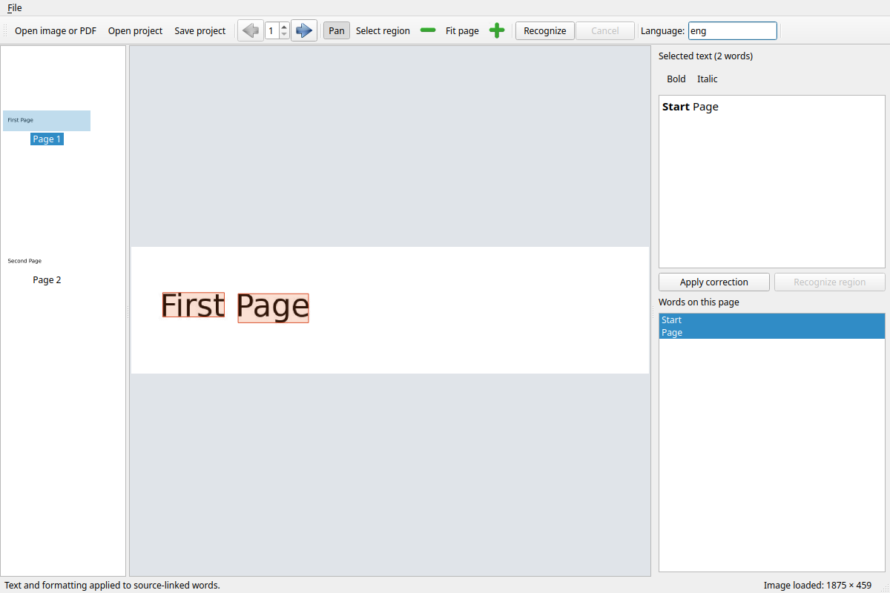

# YAGF (pre-2.0)

This is the Qt 6 and C++23 revival of YAGF. The historical Qt 4 application is available on the `legacy` branch. Tesseract runs locally by default; PaddleOCR, docTR, RapidOCR, Surya, and Kraken services are optional.

See [ARCHITECTURE.md](ARCHITECTURE.md) for the source layout, dependency boundaries, and next implementation slices.



The screenshot uses a generated sample image.

## Build

```sh
cmake -S . -B build -G Ninja
cmake --build build
ctest --test-dir build --output-on-failure
./build/yagf-revival
# Or open a source document immediately:
./build/yagf-revival /path/to/scan.png
```

Qt 6 development packages are required. Install Tesseract and language data to recognize images. PDF import and searchable PDF export also require Poppler's `pdfinfo` and `pdftoppm` commands. PDF/A export additionally requires OCRmyPDF. Scanning requires SANE's `scanimage` command and a configured scanner backend. Missing tools are reported in the app.

## Linux installation and AppImage

For a local desktop install:

```sh
cmake --install build --prefix "$HOME/.local"
```

This installs the executable, desktop entry, icon, and AppStream metadata. Make sure `$HOME/.local/bin` is on your `PATH`.

To build an x86-64 or AArch64 AppImage, install Ninja, `curl`, `qmake6`, and the Qt 6 Wayland platform plugins, then run:

```sh
./packaging/build-appimage.sh
```

The result is written to `dist/`. The script downloads the official linuxdeploy and Qt plugin AppImages on first use; set `LINUXDEPLOY` and `LINUXDEPLOY_QT_PLUGIN` to use existing copies. The AppImage bundles the Qt desktop dependencies. The Tesseract engine and PDF tools remain external commands on the host; install OCRmyPDF if you need PDF/A export. The current AppImage was built and smoke tested on Ubuntu 24.04; compatibility with older distributions has not yet been verified.

## Current workflow

Open an image or PDF. The left navigation strip shows page miniatures and saved image regions. The center is a zoomable page preview, and the right pane is a rich text editor with recognized words below it. **Select region** is active when an image opens: drag on the image to add as many OCR areas as needed before recognition. Click an area or its entry in the left list to select it; drag inside to move it, drag an edge to resize it, or press Delete (or **Delete region**) to remove it. Switch to **Pan** to move around a zoomed image. **Recognize regions** processes the saved areas in sequence; **Recognize region** processes only the active area. Without areas, **Recognize** processes the full page. Areas are saved in projects and all area changes support Undo/Redo.

After recognition, switch to **Pan** to click a word box (or Ctrl-click while drawing regions), or select consecutive words in the word list. Edit the text and use **Apply correction**. You can join words (`mod ernization` → `modernization`), split words (`ofthe` → `of the`), insert words, and delete words. Each corrected word keeps its contributing source rectangles; a merge across lines retains separate fragments, a split divides source geometry, and inserted words get an estimated box. **Bold** and **Italic** remain available. **Edit → Undo/Redo** also reverses text, layout, preprocessing, and OCR page changes; the undo history resets when opening a different source or project.

Use **File → Scan a page…** to discover SANE scanners, choose a device, resolution, and color mode, and import a page. Scanning runs in the background and can be cancelled. You can also drop a local image or PDF onto the preview, or choose **File → Paste image from clipboard** (`Ctrl+Shift+V`) for a screenshot or image copied from another app. JPEG photo orientation metadata is applied consistently to preview, OCR, and PDF export. Scans and pasted images are saved under the app's data directory. The scanner action currently imports one page per scan.

Use **Improve page…** to inspect the original beside a processed preview. **Detect skew** estimates a correction angle, which you can adjust manually; **Auto contrast** stretches faded scans, and **Denoise (grayscale)** removes isolated specks. The settings apply to the current page and to its OCR input, including region OCR. They are saved in the project and reapplied when it opens. Changing the deskew angle moves the image, so the app asks before clearing that page's OCR boxes, corrections, and drawn regions. Contrast and denoise keep the existing boxes. The source image is never overwritten.

For a PDF, choose **Tools → Recognize all pages** to OCR every page in sequence. The status bar shows progress and **Cancel** stops the queue. Existing corrections and layout settings are retained where the new OCR still matches source words and region IDs. To correct segmentation, select words on the preview and choose **Tools → Create region from selection**. **Tools → Edit layout…** lets you set each region's type and box and move regions up or down in reading order. The order controls plain-text and structured JSON export; layout HTML keeps words at their source coordinates. Region boxes are metadata and do not move individual word boxes.

**Save project** writes a versioned `.yagf.json` file with corrections for all recognized pages; **Open project** restores the pages, boxes, edits, and word formatting. If the source is beside the project, its path is stored relative to the project. **Save portable project folder…** copies the source into an `assets/` folder and writes `project.yagf.json`; move that whole folder to another computer and use **Open portable project folder…**. The source copy is checked by SHA-256 when opened. The title shows `*` for unsaved work, and opening another document or closing the window prompts to save. The **File** menu exports plain text, structured JSON, layout HTML, a searchable PDF, or PDF/A. PDF export uses the source image with an invisible text layer made from the corrected words, so text extraction uses your edits. PDF/A conversion uses OCRmyPDF without rerunning OCR on that text layer. Pages are rendered on demand at 150 DPI; exported PDFs use the same resolution. PDF export runs in a worker thread with progress and cancellation. OCR and thumbnail generation run in subprocesses, and **Cancel** stops the current job.

The project and document JSON schemas are version 2. They record the source path, source and processed page dimensions, per-page quality settings, user-drawn image regions, engine ID and language, stable page/region/paragraph/line/word IDs, reading order, each word's source fragments and union box, original reading, current reading, source word IDs, confidence, review state, and basic formatting. Version 1 projects and earlier version 2 projects still load. Coordinates are pixels in the processed page image. Corrections survive a rerun when the recognized word and box match exactly. OCR does not recover exact fonts or complete column layout; the editor keeps detected line and paragraph breaks and estimates relative text size. The searchable PDF text layer currently uses each word's union box. Flatpak packaging and broader release testing remain before a complete 2.0 release.

Recognition runs through `IOcrEngine` in `processing/`. Tesseract is the default provider. Choose **Tools → OCR engine…** to use an optional remote service and enter its URL and bearer token if configured. The token stays in memory for this session; each provider's URL is saved in desktop settings. PaddleOCR and RapidOCR return line boxes, docTR and Kraken return word boxes, and Surya returns ordered layout blocks with region types. See [service/README.md](service/README.md) for setup and the HTTP protocol. `DocumentProcessor` runs engine work asynchronously and handles PDF rendering, batching, and cancellation. The `core` document model has no Python or inference framework dependency.

For a document with mixed languages, choose **Tools → Choose OCR languages…** and check the installed Tesseract languages, or enter a combination such as `eng+deu` in the OCR field. The first language is primary. The selected combination is used for page, region, and batch recognition and saved with recognized pages. Tesseract's [language syntax and order behavior](https://github.com/tesseract-ocr/tessdoc/blob/main/Command-Line-Usage.md#using-multiple-languages) are documented upstream. PaddleOCR uses one configured model language per service; docTR, RapidOCR, Surya, and Kraken use `auto` in YAGF because their model vocabulary is selected by the service.

To review a doubtful word, select it in the image or word list and click **Review word…**. YAGF marks unreviewed words below 70% confidence in amber. The dialog shows the source letters at adjustable magnification in original, higher contrast, and black-and-white views. You can type a correction directly, or enter a vision model name and a complete OpenAI-compatible chat-completions endpoint, then click **Ask AI for readings**. A local [llama.cpp server with a vision model](https://github.com/ggml-org/llama.cpp/blob/master/tools/server/README.md#post-v1chatcompletions-openai-compatible-chat-completions-api) is one option. Only that explicit click sends the cropped image and nearby text. The model's suggestions are never applied automatically: choose a candidate, inspect its letters, and click **Use correction**. The correction uses the existing undo stack. Endpoint and model are saved in desktop settings; the optional bearer token stays in memory. No AI model is bundled with YAGF.

### Reconstructing uncertain passages

Choose **Tools → Document context…** to describe the document's subject, period, terminology or names; for example, “A German physics textbook about thermodynamics, published in 1920.” The description is saved with the project and supports Undo/Redo. Leave it empty to let the configured AI infer the subject from earlier recognized text, or combine both sources of context.

**Use earlier recognized text to infer subject and terminology** is enabled by default for each document. Word and passage review collect excerpts from up to three recent pages, including text before the selection on the current page, with the same OCR language setting. Excerpts include reviewed readings and unchanged OCR at 90% confidence or higher; omitted uncertain words are marked with `[…]`. The selected passage and later pages are excluded. Context is rebuilt for each review, so edits and Undo immediately affect the evidence. The description is limited to 4,000 characters and the excerpts to 6,000.

Select an uncertain word or passage, open **Review word…** or **Review passage…**, inspect the document context shown above the image, and click **Ask AI for readings**. This sends the description and excerpts together with the source crop and nearby text to your configured vision model. The model uses the subject to distinguish visually plausible readings and is instructed to return no candidates when the pixels are insufficient. Only **Use correction** changes the transcription. This adds context to the AI reconstruction step; page OCR continues to use the selected OCR engine. No separate summarization request is made.

Keep Tesseract as the page engine and open **Tools → Specialist OCR…**. Enable **Formulas with Surya**, **Uncertain text with docTR**, or both. Enter the base URL of each running service and its bearer token if needed. This opts in for the current session. The services receive cropped line images during page, region and PDF batch recognition.

Tesseract provides the first reading and word positions. Lines containing common mathematical operators or lying in a layout region marked as an equation go to Surya. A line with any word below 70% confidence can go to docTR. Formula recognition takes priority when both routes qualify. If a service fails, YAGF reports the error and keeps the primary OCR. This pass relies on Tesseract locating text on the page. For an equation it misses entirely, use Surya directly on a drawn region.

Choose **Tools → Review next specialist reading…** on the current page to compare a differing transcription with the original and the scan. **Copy specialist reading to editor** lets you use or edit it. **Ask AI for readings** uses the marked crop, nearby text and both transcriptions to propose a context-based reading. You can also select consecutive words and use **Review passage…** with a configured vision model independently of specialist OCR. Only **Use correction** changes the document. Pending alternatives survive saving and reopening the project. Accepted verbatim specialist readings record the contributing engine and support Undo.

## Scientific books

Choose **Tools → OCR engine… → Surya**, open a scan, and recognize the page or use **Tools → Recognize all pages** for a PDF. The Surya service detects layout, predicts reading order, and transcribes inline and display mathematics into LaTeX. Tables retain row and cell boundaries, header cells, and merged-cell spans. Figures and diagrams retain their source rectangles even when they contain no recognized text. See the [service setup](service/README.md#surya).

Select one layout block to edit its transcription. In a table, tabs separate cells and newlines separate rows. In **Tools → Edit layout…**, compare the ordered regions with the page, correct a label or figure crop, and move regions up or down. Save the project to retain these edits.

**File → Export scientific book as HTML…** writes a self-contained, reflowable document in the reviewed reading order. It includes selectable LaTeX source, HTML tables and embedded PNG figure crops. A caption immediately above or below a single figure or table stays with it. Ambiguous and separated captions remain at their reading positions. Plain text and JSON exports also include the LaTeX transcription. Check equations, table alignment and multi-column order against the scan before publication.

## Learn from corrections

For a large PDF, recognize and review a few early pages, then choose **Tools → Recognize remaining pages**. This skips pages that already contain OCR, including pages with reviewed corrections. Stop and resume the batch when you want to review more pages.

Before each local Tesseract job, YAGF builds a case-sensitive vocabulary from earlier pages in the same document with the same OCR language setting. A reviewed source word qualifies immediately. An unreviewed reading qualifies after Tesseract or another word-box engine reports it at 95% confidence or higher on two separate pages. Correcting a reading removes its automatic support for later jobs. Up to 4,096 terms, prioritizing verified readings, are supplied through Tesseract’s temporary [user words file](https://github.com/tesseract-ocr/tesseract/blob/main/doc/tesseract.1.asc). Page and region OCR use the same hints as batch OCR. Tesseract still decides what the image says.

For an isolated symbol from a word-box engine, YAGF also saves a small shape sample with its OCR box. Select a symbol below 85% confidence to see whether its normalized shape exactly matches an earlier example. A visual suggestion requires either a reviewed reading or readings at 95% confidence on two earlier pages, with agreement across the matching evidence. You can accept a suggestion in **Review word…**. Earlier projects can supply vocabulary immediately. Recognizing a page with this version adds the shape samples.

For scans with slight shifts or ink variation, enable **Tools → Match similar symbol images**. When there is no earlier exact example in the same OCR language, YAGF tries offsets of up to one cell on its 16 × 16 grid. A match requires at least 90% overlap of the combined ink area, with every ink cell within one cell of ink in the other image. Conflicting readings suppress the visual suggestion. The option works locally with shape samples already saved in the project.

After you correct `QWldget` to `QWidget`, selecting another unreviewed `QWldget` anywhere in the same book shows **Review suggestion: QWidget…**. Open the review, choose a reading from **Choose a correction from this book**, compare it with the scan, and click **Use correction**. Cancel discards the choice. Undo and redo update both the word and the suggestions it contributes. Saving and reopening the project restores its correction memory.

Matching is local and case-sensitive. Exact OCR readings take priority. When there is no exact match, alphabetic tokens of 5–80 letters can match a previous OCR reading by one insertion, deletion, or substitution. Digits and punctuation require an exact match. Up to three alternatives show the OCR reading, replacement, match type, and number of examples. Matching words immediately before or after the target on the same line rank alternatives, followed by example count.

**File → Export verified corrections…** writes one JSON Lines record per eligible word across the book. Each record contains the corrected `text`, `original_text`, a base64-encoded PNG crop in `png_base64`, the page and word IDs, OCR engine, language, confidence, and processed-page pixel box `[x, y, width, height]`. The export uses the same page orientation, PDF resolution, and preprocessing as the editor. It runs locally and can be cancelled.

Both memory and export use reviewed single-token text changes with one source word, one matching source box, and recorded OCR confidence. This excludes unchanged readings, inserted words, and estimated split or merged boxes. The exported pairs can be used for later model training.

## Audit and direction

The build on the `legacy` branch requires Qt 4 and Aspell. The old UI is oriented around image regions and free text rather than persistent word geometry. Its sources are GPL-3.0-or-later (see `COPYING`). Reusing selected image tools may be useful later, but directly porting the full UI would delay the proposal's defining source-linked correction workflow. The new code therefore starts as an independent Qt 6 frontend in `src/`.
