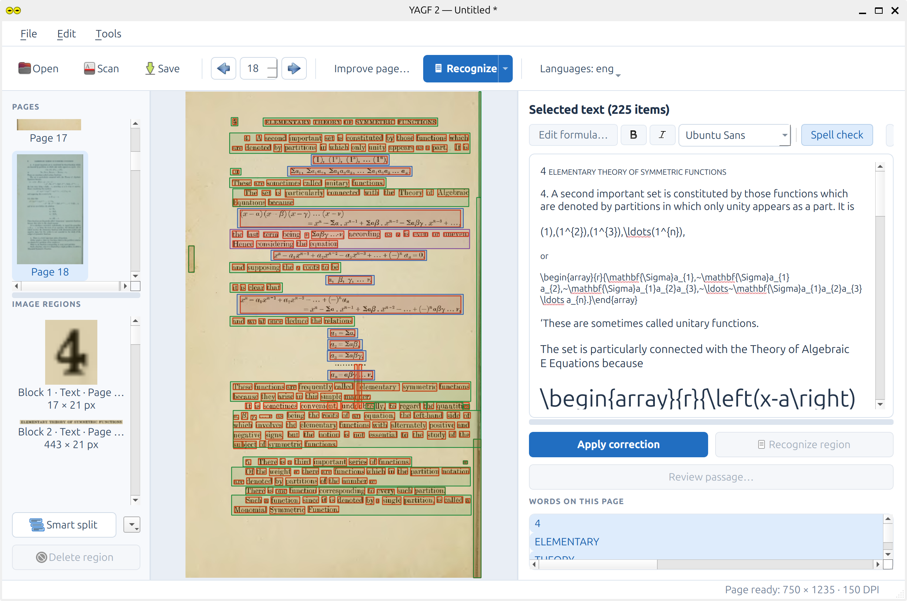

# YAGF 2

**AI-assisted OCR, mathematical formula recognition, and document review for Linux.**

Turn scanned books, PDFs, DjVu files, and photographed pages into editable text
and LaTeX. Combine local Tesseract with neural OCR engines, vision models, and
AI page-layout detection. Inspect each result against the original scan and
approve corrections before exporting your document.

## Capabilities

- **AI page understanding.** Detect text, formulas, tables, and pictures with
  PP-DocLayoutV3. Review detected regions and route text and equations to
  independently selected recognition models. Resplit a selected block with AI.
- **AI-assisted correction.** Ask a vision model to inspect an uncertain word or
  passage using its source crop, nearby text, and document context. Compare its
  suggested readings and choose which correction to apply.
- **Multiple OCR engines in one workspace.** Discover available models, choose
  separate text and formula engines, and run companion engines to compare their
  readings.
- **Native AI results.** Keep Markdown, table structures, formulas, figures,
  layout relationships, and model provenance alongside editable text. Models
  without word coordinates remain editable as blocks.
- **A complete math workflow.** Recognize equations as LaTeX, edit them with a
  live rendered preview, use supported Unicode formulas, and export LaTeX or
  typeset formulas in formatted PDFs.
- **Source-linked editing and review.** Select words or blocks directly on the
  scan, check spelling, work through a verification queue, and undo edits.
  Reviewed corrections survive recognition reruns when safely matched.
- **Page preparation and batch OCR.** Rotate, deskew, improve contrast, restore
  damaged scans, edit regions, and recognize individual blocks or entire books.
  Saved coordinate transforms preserve text and corrections as geometry changes.
  Import images, PDFs, DjVu files, scanner pages, and clipboard images.
- **Learning and evaluation.** Teach recurring symbol errors, adapt native OCR
  profiles from reviewed examples, and compare pipelines using CER/WER and timing
  measurements in the experiments window or `yagf2-benchmark` CLI.
- **Document export.** Export the current page or a whole document. Produce editable Word
  documents (.docx) with Pandoc, searchable or formatted PDFs, HTML, plain text,
  structured JSON, LaTeX documents, and portable projects. Optional host tools
  provide DjVu conversion and PDF/A export.

## Supported OCR engines and AI integrations

| Engine or model | Recognition / role | Integration |
| --- | --- | --- |
| **Tesseract** | Text OCR with installed language models | Local, default engine |
| **PaddleOCR** | Text OCR | Optional OCR service |
| **PP-OCRv6 small / medium** | Text OCR with explicit detection and recognition models | Optional Paddle service presets |
| **PaddleOCR-VL** | Vision-based text and formula recognition | Direct vision server or YAGF bridge |
| **GLM-OCR** | Text, formulas, and tables | Optional bridge to a running vision server |
| **LightOnOCR-3-0.8B** | Text, formulas, tables, and grounded page blocks | Optional bridge to a running vision server |
| **MinerU2.5-Pro** | Structured document extraction with block coordinates | Optional MinerU SDK bridge |
| **Chandra OCR 2** | Document text, math, tables, and layout | Optional Chandra SDK bridge |
| **docTR** | Text OCR and specialist readings for uncertain text | Optional OCR service |
| **docTR FormulaNet** | Formula crops to LaTeX | Optional formula-only docTR worker |
| **RapidOCR** | Text-line recognition with ONNX models | Optional OCR service |
| **Surya** | Text, mathematics, ordered layout blocks, and tables | Optional OCR service |
| **Kraken** | Text OCR with a selected recognition model | Optional OCR service |
| **Rapid LaTeX OCR** | Formula images to LaTeX | Optional local Python runtime |
| **PP-FormulaNet_plus-L** | Dedicated formula recognition | Optional formula-only worker |
| **PP-DocLayoutV3** | AI page-region detection | Optional layout worker |
| **Adapted native OCR profiles** | Tesseract, Kraken, and configured PaddleOCR training/inference profiles | Native training worker |
| **OpenAI-compatible vision models** | AI-assisted word and passage review | User-configured vision service |

Choose text, formula, and layout models in **Tools → Recognition settings…**.
Services can run on the same computer or a separate inference host, including a
Jetson. Model weights and optional Python runtimes are installed separately;
PaddleOCR adaptation requires a configured native training environment. See
[OCR services](service/README.md), [model discovery](service/OCR_DISCOVERY.md),
and [native training](service/NATIVE_TRAINING.md) for setup.

Built with **Qt 6** and **C++23**.



*A scanned mathematics book with source regions and recognized text shown side by side.*


*Edit a recognized equation in LaTeX and inspect its rendered preview.*

## Install on Ubuntu

### Ubuntu package

Build a `.deb` on the Ubuntu release and architecture where it will be used:

```sh
git clone https://github.com/andrei-b/YAGF.git
cd YAGF
./packaging/install-build-deps-ubuntu.sh
./packaging/build-deb.sh
sudo apt install ./dist/yagf2_2.2.0-1_amd64.deb
```

The builder detects the version and native architecture. The example filename is
for version 2.2.0 on amd64; arm64 builds produce an arm64 package. The package
installs the GUI, benchmark CLI, documentation, and optional service templates.
APT resolves the Qt/OpenCV libraries, Tesseract, and Poppler dependencies.

### AppImage

```sh
./packaging/build-appimage.sh
chmod +x dist/YAGF-2.2.0-x86_64.AppImage
./dist/YAGF-2.2.0-x86_64.AppImage
```

AppImages can be built on x86-64 or AArch64 Linux. Qt and OpenCV are bundled;
Tesseract, PDF tools, and LaTeX stay on the host. Each builder writes a SHA256
checksum beside its artifact in `dist/`.

If FUSE is unavailable, run with `--appimage-extract-and-run`. Compatibility with
older distributions than the build host requires separate testing. See the
[packaging guide](packaging/README.md) for build options and runtime dependencies.

## Enable OCR and formula previews

For local OCR and PDF processing when using the AppImage or a source install:

```sh
sudo apt install tesseract-ocr tesseract-ocr-eng poppler-utils
```

Add the language data you need, for example `tesseract-ocr-rus` or
`tesseract-ocr-deu`. Use `eng+rus` for a mixed English/Russian document.

For live LaTeX previews and typesetting Latin/Cyrillic documents with tables:

```sh
sudo apt install texlive-latex-base texlive-latex-recommended texlive-latex-extra \
  texlive-fonts-recommended texlive-lang-cyrillic cm-super-minimal
```

Formula previews use `pdflatex` and `pdftoppm`. LaTeX source editing and export
remain available without a TeX installation. Scanning uses `sane-utils` and,
for AirScan discovery, `sane-airscan`; DjVu uses `djvulibre-bin`; PDF/A uses
`ocrmypdf`. Spelling checks use Enchant 2 and installed dictionaries.

## First document

1. **Open** an image, PDF, or DjVu file, **Scan** a page, or paste an image with
   **Ctrl+Shift+V**.
2. Open **Tools → Recognition settings…**. Select the text model and language,
   then choose a formula model independently. **Refresh models** checks configured
   hosts and service URLs. Selections take effect when you save.
3. Use **Smart split** or **Tools → Page & layout → AI page areas…** to inspect
   the page regions. Set a block's type and language where needed.
4. Click **Recognize** for the page or selected blocks. Its dropdown includes
   whole-document recognition and **Math only** mode.
5. Select text or a source block to correct it. Use **Edit formula…** for LaTeX
   and **Navigate** to jump between formulas, problem blocks, and uncertain words across pages.
6. **Save** the project, then use **File → Export** for the desired output.

**PgUp / PgDown** navigate document pages, including while the editor has focus.
**Ctrl+Shift+J** opens the document navigator. **F4 / Shift+F4** move to the next or previous result in the active view. Use **Edit → Undo/Redo**
to reverse or restore edits.

Tools are grouped into **Recognition**, **Page & layout**, **Review**, and
**Training & experiments**. **Recognition settings…** stays directly under Tools.

## Remote models and training

The desktop works with local Tesseract. Optional HTTP services provide additional
text, formula, layout, and training capabilities on a configured inference host,
including a Jetson. Model weights and Python runtimes are installed separately;
the desktop package does not download models or enable services automatically.

- [Model discovery, separate text/formula selection, and SSH tunnels](service/OCR_DISCOVERY.md)
- [Remote OCR and page-layout services](service/README.md)
- [Native OCR training and adaptation](service/NATIVE_TRAINING.md)
- [Symbol training service](service/SYMBOL_TRAINING.md)
- [OCR experiments and benchmark CLI](docs/experiments.md)

### Recognition evidence and decisions

With the experimental inline-script build of Tesseract on your PATH, select a recognized word in YAGF and click a raised or lowered character in the text editor. The scan highlights the character box supplied by Tesseract. Saving the project preserves the placement. Layout HTML, scientific HTML, LaTeX, Word, and formatted PDF can render the recorded script positions.

A command-line tool can reread marked subscripts with two English Tesseract models and suggest corrections for review. [Usage and results on book scans](docs/benchmarks/tesseract-subscript-rereading.md)

Every recognition attempt is retained in the project: engine and model identity, reported version/hash, exact input PNG, source-file and preprocessing SHA-256 fingerprints, original coordinate mappings, full structured output, elapsed time, errors and warnings. Tesseract also records its version, traineddata fingerprints and original TSV. Remote retries retain their individual responses and crop coordinates. Shared input images and coordinate frames are stored once per page.

Open **Review OCR readings → Recognition history…** to inspect a run and its crop, output, preprocessing, coordinate frames and decisions. Accepting a companion or specialist reading records an acceptance; **Reject this reading** or keeping a specialist's original text records a rejection. Review choices apply when you save the review window and support Undo/Redo.

Rerunning OCR, recognizing selected blocks and changing preprocessing retain earlier evidence. Failed and cancelled attempts are retained without replacing the current text. Unknown model versions, hashes and original-image mappings remain explicitly unknown; YAGF cannot recover processing steps that a remote service does not report. Older projects remain readable. History increases project size; oversized or invalid history produces a save error instead of being silently removed.

## Build and test from source

Enable the public-file commit audit once per clone:

```sh
./packaging/install-git-hooks.sh
```

The audit runs before commits, merge commits and `git am`. It reads the staged
Git snapshot and rejects detected private configuration, keys, deployment paths
and concrete service addresses. Real deployment settings belong in private local
configuration. You can check staged content manually with
`python3 packaging/check-public-files.py --staged`.

On Ubuntu, `packaging/install-build-deps-ubuntu.sh` installs the compiler, CMake,
Ninja, Qt 6 development packages, OpenCV, and packaging tools. Use `--print` to
inspect the package list first.

```sh
cmake -S . -B build -G Ninja -DCMAKE_BUILD_TYPE=Release
cmake --build build --parallel 4
ctest --test-dir build --output-on-failure
./build/yagf2 /path/to/book.pdf
```

For a user-local install:

```sh
cmake --install build --prefix "$HOME/.local"
```

Ensure `~/.local/bin` is on your desktop session's PATH. Build requirements are
CMake 3.21+, a C++23 compiler, Qt 6.2+, and OpenCV 4.4+ with core, imgproc,
features2d, and calib3d. Build `.deb` and AppImage artifacts with the scripts in
[packaging](packaging/README.md); additional CMake arguments are supported.

## Documentation and license

- [User guide](docs/user-guide.md): detailed recognition, correction, layout,
  export, and training workflows.
- [Packaging guide](packaging/README.md): Ubuntu packages, AppImages, and optional
  runtime tools.
- [Architecture](ARCHITECTURE.md): source layout and component boundaries.
- [Authors](AUTHORS) and [GPL-3.0-or-later license](COPYING).

The historical Qt 4 application is preserved on the
[`legacy` branch](https://github.com/andrei-b/YAGF/tree/legacy).
