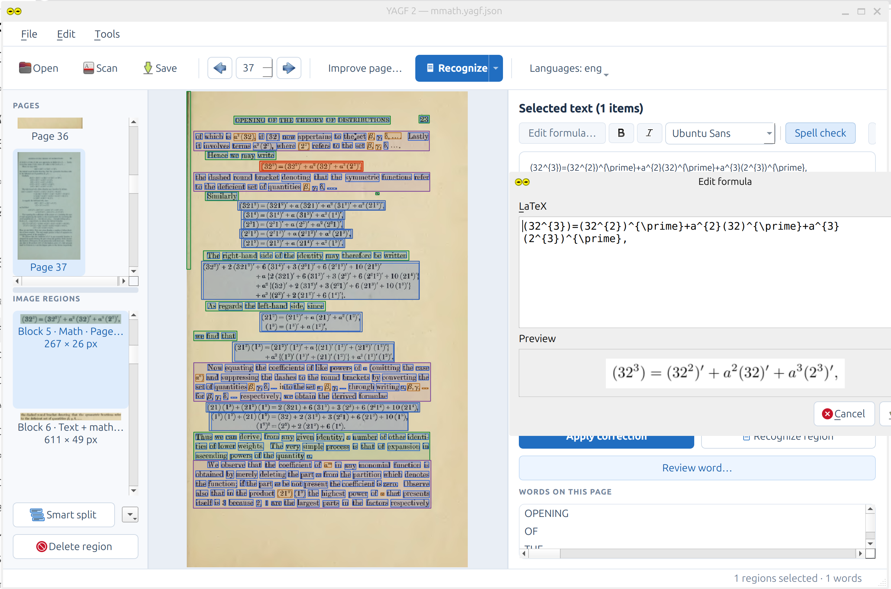

# YAGF 2

A Linux OCR editor for scanned books, documents, and mathematical text. Recognize
pages, correct text against the original image, and keep formulas, page regions,
and reviewed corrections together in a project.

Built with **Qt 6** and **C++23**. Local text recognition uses **Tesseract**;
additional OCR, formula, and page-layout models can run on a remote machine.


*A scanned mathematics book with source regions and recognized text shown side by side.*

## What you can do

- **Recognize text and mathematics separately.** Choose independent text and
  formula models in one settings window. Discover compatible services, including
  PaddleOCR-VL and the formula-only PP-FormulaNet_plus-L worker.
- **Correct against the scan.** Select words or blocks, inspect their source
  pixels, edit text and LaTeX, and undo changes. Reviewed corrections are retained
  across recognition when they can be matched safely.
- **Prepare difficult pages.** Rotate, deskew, improve contrast, restore damaged
  scans, and split pages into text, formula, mixed, picture, or excluded regions.
  Optional AI layout detection can identify page areas before OCR.
- **Review a book systematically.** Use the verification queue, spelling checks,
  alternative OCR readings, and batch recognition. Teach recurring symbol errors
  or adapt a native OCR model from reviewed examples.
- **Export your work.** Save text, HTML, structured JSON, searchable or formatted
  PDFs, LaTeX documents, and portable projects. DjVu conversion and PDF/A export
  use optional host tools.
- **Compare engines.** The desktop experiments window and `yagf2-benchmark` CLI
  measure OCR pipelines against explicitly verified reference pages.



*Edit a recognized equation in LaTeX and inspect its rendered preview.*

## Install on Ubuntu

### Ubuntu package

Build a `.deb` on the Ubuntu release and architecture where it will be used:

```sh
git clone https://github.com/andrei-b/YAGF.git
cd YAGF
./packaging/install-build-deps-ubuntu.sh
./packaging/build-deb.sh
sudo apt install ./dist/yagf2_2.2.0-1_amd64.deb
```

The builder detects the version and native architecture. The example filename is
for version 2.2.0 on amd64; arm64 builds produce an arm64 package. The package
installs the GUI, benchmark CLI, documentation, and optional service templates.
APT resolves the Qt/OpenCV libraries, Tesseract, and Poppler dependencies.

### AppImage

```sh
./packaging/build-appimage.sh
chmod +x dist/YAGF-2.2.0-x86_64.AppImage
./dist/YAGF-2.2.0-x86_64.AppImage
```

AppImages can be built on x86-64 or AArch64 Linux. Qt and OpenCV are bundled;
Tesseract, PDF tools, and LaTeX stay on the host. Each builder writes a SHA256
checksum beside its artifact in `dist/`.

If FUSE is unavailable, run with `--appimage-extract-and-run`. Compatibility with
older distributions than the build host requires separate testing. See the
[packaging guide](packaging/README.md) for build options and runtime dependencies.

## Enable OCR and formula previews

For local OCR and PDF processing when using the AppImage or a source install:

```sh
sudo apt install tesseract-ocr tesseract-ocr-eng poppler-utils
```

Add the language data you need, for example `tesseract-ocr-rus` or
`tesseract-ocr-deu`. Use `eng+rus` for a mixed English/Russian document.

For live LaTeX previews and typesetting Latin/Cyrillic documents with tables:

```sh
sudo apt install texlive-latex-base texlive-latex-recommended texlive-latex-extra \
  texlive-fonts-recommended texlive-lang-cyrillic cm-super-minimal
```

Formula previews use `pdflatex` and `pdftoppm`. LaTeX source editing and export
remain available without a TeX installation. Scanning uses `sane-utils` and,
for AirScan discovery, `sane-airscan`; DjVu uses `djvulibre-bin`; PDF/A uses
`ocrmypdf`. Spelling checks use Enchant 2 and installed dictionaries.

## First document

1. **Open** an image, PDF, or DjVu file, **Scan** a page, or paste an image with
   **Ctrl+Shift+V**.
2. Open **Tools → Recognition settings…**. Select the text model and language,
   then choose a formula model independently. **Refresh models** checks configured
   hosts and service URLs. Selections take effect when you save.
3. Use **Smart split** or **Tools → Page & layout → AI page areas…** to inspect
   the page regions. Set a block's type and language where needed.
4. Click **Recognize** for the page or selected blocks. Its dropdown includes
   whole-document recognition and **Math only** mode.
5. Select text or a source block to correct it. Use **Edit formula…** for LaTeX
   and **Tools → Review → Verification queue** to work through detected issues.
6. **Save** the project, then use **File → Export** for the desired output.

**PgUp / PgDown** navigate document pages, including while the editor has focus.
**F4 / Shift+F4** move between verification issues. Use **Edit → Undo/Redo**
to reverse or restore edits.

Tools are grouped into **Recognition**, **Page & layout**, **Review**, and
**Training & experiments**. **Recognition settings…** stays directly under Tools.

## Remote models and training

The desktop works with local Tesseract. Optional HTTP services provide additional
text, formula, layout, and training capabilities on a configured inference host,
including a Jetson. Model weights and Python runtimes are installed separately;
the desktop package does not download models or enable services automatically.

- [Model discovery, separate text/formula selection, and SSH tunnels](service/OCR_DISCOVERY.md)
- [Remote OCR and page-layout services](service/README.md)
- [Native OCR training and adaptation](service/NATIVE_TRAINING.md)
- [Symbol training service](service/SYMBOL_TRAINING.md)
- [OCR experiments and benchmark CLI](docs/experiments.md)

## Build and test from source

Enable the public-file commit audit once per clone:

```sh
./packaging/install-git-hooks.sh
```

The audit runs before commits, merge commits and `git am`. It reads the staged
Git snapshot and rejects detected private configuration, keys, deployment paths
and concrete service addresses. Real deployment settings belong in private local
configuration. You can check staged content manually with
`python3 packaging/check-public-files.py --staged`.

On Ubuntu, `packaging/install-build-deps-ubuntu.sh` installs the compiler, CMake,
Ninja, Qt 6 development packages, OpenCV, and packaging tools. Use `--print` to
inspect the package list first.

```sh
cmake -S . -B build -G Ninja -DCMAKE_BUILD_TYPE=Release
cmake --build build --parallel 4
ctest --test-dir build --output-on-failure
./build/yagf2 /path/to/book.pdf
```

For a user-local install:

```sh
cmake --install build --prefix "$HOME/.local"
```

Ensure `~/.local/bin` is on your desktop session's PATH. Build requirements are
CMake 3.21+, a C++23 compiler, Qt 6.2+, and OpenCV 4.4+ with core, imgproc,
features2d, and calib3d. Build `.deb` and AppImage artifacts with the scripts in
[packaging](packaging/README.md); additional CMake arguments are supported.

## Documentation and license

- [User guide](docs/user-guide.md): detailed recognition, correction, layout,
  export, and training workflows.
- [Packaging guide](packaging/README.md): Ubuntu packages, AppImages, and optional
  runtime tools.
- [Architecture](ARCHITECTURE.md): source layout and component boundaries.
- [Authors](AUTHORS) and [GPL-3.0-or-later license](COPYING).

The historical Qt 4 application is preserved on the
[`legacy` branch](https://github.com/andrei-b/YAGF/tree/legacy).
