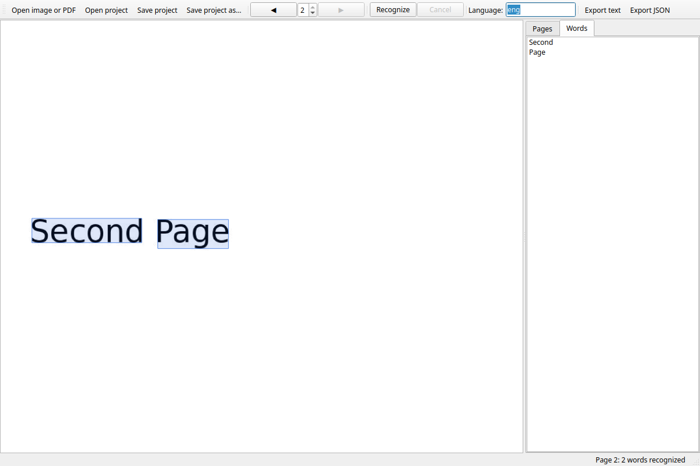

# YAGF Revival prototype

This is the Qt 6 and C++23 revival of YAGF. The Qt 4 application remains in the repository root. Tesseract runs locally by default; PaddleOCR and docTR services are optional.

See [ARCHITECTURE.md](ARCHITECTURE.md) for the source layout, dependency boundaries, and next implementation slices.



The screenshot uses a generated sample image.

## Build

```sh
cmake -S revival -B build-revival -G Ninja
cmake --build build-revival
ctest --test-dir build-revival --output-on-failure
./build-revival/yagf-revival
# Or open a source document immediately:
./build-revival/yagf-revival /path/to/scan.png
```

Qt 6 development packages are required. Install Tesseract and language data to recognize images. PDF import and searchable PDF export also require Poppler's `pdfinfo` and `pdftoppm` commands. PDF/A export additionally requires OCRmyPDF. Scanning requires SANE's `scanimage` command and a configured scanner backend. Missing tools are reported in the app.

## Linux installation and AppImage

For a local desktop install:

```sh
cmake --install build-revival --prefix "$HOME/.local"
```

This installs the executable, desktop entry, icon, and AppStream metadata. Make sure `$HOME/.local/bin` is on your `PATH`.

To build an x86-64 or AArch64 AppImage, install Ninja, `curl`, `qmake6`, and the Qt 6 Wayland platform plugins, then run:

```sh
./revival/packaging/build-appimage.sh
```

The result is written to `dist/`. The script downloads the official linuxdeploy and Qt plugin AppImages on first use; set `LINUXDEPLOY` and `LINUXDEPLOY_QT_PLUGIN` to use existing copies. The AppImage bundles the Qt desktop dependencies. The Tesseract engine and PDF tools remain external commands on the host; install OCRmyPDF if you need PDF/A export. The current AppImage was built and smoke tested on Ubuntu 24.04; compatibility with older distributions has not yet been verified.

## Current workflow

Open an image or PDF. The left navigation strip fills with page miniatures in the background; click one or use the arrow buttons to change pages. The center is a zoomable page preview, and the right pane is a rich text editor with the page's recognized words below it. Press **Recognize** for the full page. Switch to **Select region** and drag on the preview to select overlapping OCR words, or press **Recognize region** to OCR only the selected image area. Click a word box or select consecutive words in the word list, then edit the text and use **Apply correction**. You can join words (`mod ernization` → `modernization`), split words (`ofthe` → `of the`), insert words, and delete words. Each corrected word keeps its contributing source rectangles; a merge across lines retains separate fragments, a split divides source geometry, and inserted words get an estimated box. **Bold** and **Italic** remain available. **Edit → Undo/Redo** reverses text, layout, preprocessing, and OCR page changes; the undo history resets when opening a different source or project.

Use **File → Scan a page…** to discover SANE scanners, choose a device, resolution, and color mode, and import a page. Scanning runs in the background and can be cancelled. You can also drop a local image or PDF onto the preview, or choose **File → Paste image from clipboard** (`Ctrl+Shift+V`) for a screenshot or image copied from another app. JPEG photo orientation metadata is applied consistently to preview, OCR, and PDF export. Scans and pasted images are saved under the app's data directory. The scanner action currently imports one page per scan.

Use **Improve page…** to inspect the original beside a processed preview. **Detect skew** estimates a correction angle, which you can adjust manually; **Auto contrast** stretches faded scans, and **Denoise (grayscale)** removes isolated specks. The settings apply to the current page and to its OCR input, including region OCR. They are saved in the project and reapplied when it opens. Changing the deskew angle moves the image, so the app asks before clearing that page's existing OCR boxes and corrections. Contrast and denoise keep the existing boxes. The source image is never overwritten.

For a PDF, choose **Tools → Recognize all pages** to OCR every page in sequence. The status bar shows progress and **Cancel** stops the queue. Existing corrections and layout settings are retained where the new OCR still matches source words and region IDs. To correct segmentation, select words on the preview and choose **Tools → Create region from selection**. **Tools → Edit layout…** lets you set each region's type and box and move regions up or down in reading order. The order controls plain-text and structured JSON export; layout HTML keeps words at their source coordinates. Region boxes are metadata and do not move individual word boxes.

**Save project** writes a versioned `.yagf.json` file with corrections for all recognized pages; **Open project** restores the pages, boxes, edits, and word formatting. If the source is beside the project, its path is stored relative to the project. **Save portable project folder…** copies the source into an `assets/` folder and writes `project.yagf.json`; move that whole folder to another computer and use **Open portable project folder…**. The source copy is checked by SHA-256 when opened. The title shows `*` for unsaved work, and opening another document or closing the window prompts to save. The **File** menu exports plain text, structured JSON, layout HTML, a searchable PDF, or PDF/A. PDF export uses the source image with an invisible text layer made from the corrected words, so text extraction uses your edits. PDF/A conversion uses OCRmyPDF without rerunning OCR on that text layer. Pages are rendered on demand at 150 DPI; exported PDFs use the same resolution. PDF export runs in a worker thread with progress and cancellation. OCR and thumbnail generation run in subprocesses, and **Cancel** stops the current job.

The project and document JSON schemas are version 2. They record the source path, source and processed page dimensions, per-page quality settings, engine ID and language, stable page/region/paragraph/line/word IDs, reading order, each word's source fragments and union box, original reading, current reading, source word IDs, confidence, review state, and basic formatting. Version 1 projects and earlier version 2 projects still load. Coordinates are pixels in the processed page image. Corrections survive a rerun when the recognized word and box match exactly. OCR does not recover exact fonts or complete column layout; the editor keeps detected line and paragraph breaks and estimates relative text size. The searchable PDF text layer currently uses each word's union box. Flatpak packaging and broader release testing remain before a complete 2.0 release.

Recognition runs through `IOcrEngine` in `processing/`. Tesseract is the default provider. Choose **Tools → OCR engine…** to use a remote PaddleOCR or docTR service and enter its URL and optional bearer token. The token stays in memory for this session; each provider's URL is saved in desktop settings. PaddleOCR returns text-line boxes, which the correction editor can split into estimated word boxes. docTR returns word boxes with block and line structure. See [service/README.md](service/README.md) for setup and the HTTP protocol. `DocumentProcessor` runs engine work asynchronously and handles PDF rendering, batching, and cancellation. The `core` document model has no Python, PaddleOCR, docTR, or Jetson dependency.

## Audit and direction

The original root CMake build requires Qt 4 and Aspell. The old UI is oriented around image regions and free text rather than persistent word geometry. Its sources are GPL-3.0-or-later (see `COPYING`). Reusing selected image tools may be useful later, but directly porting the full UI would delay the proposal's defining source-linked correction workflow. The new code therefore starts as an independent Qt 6 frontend in this directory.
